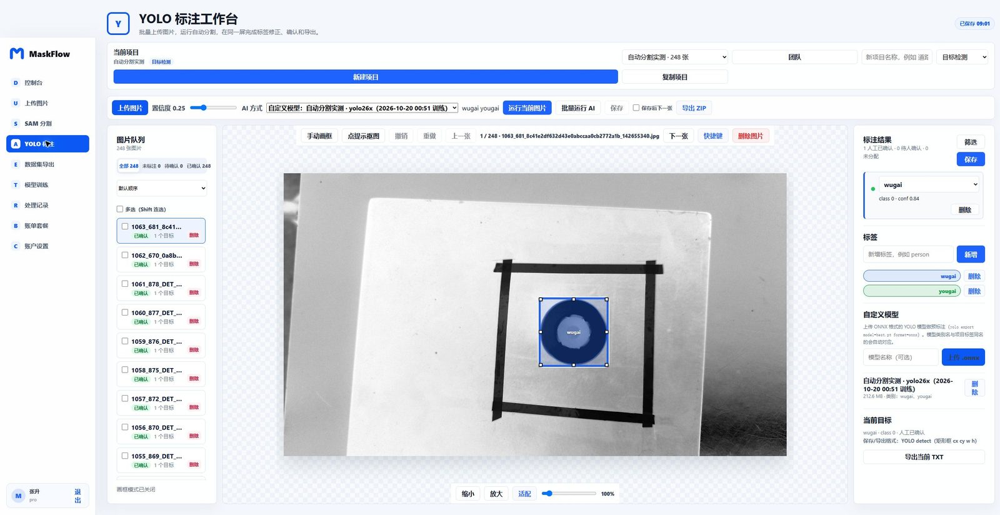
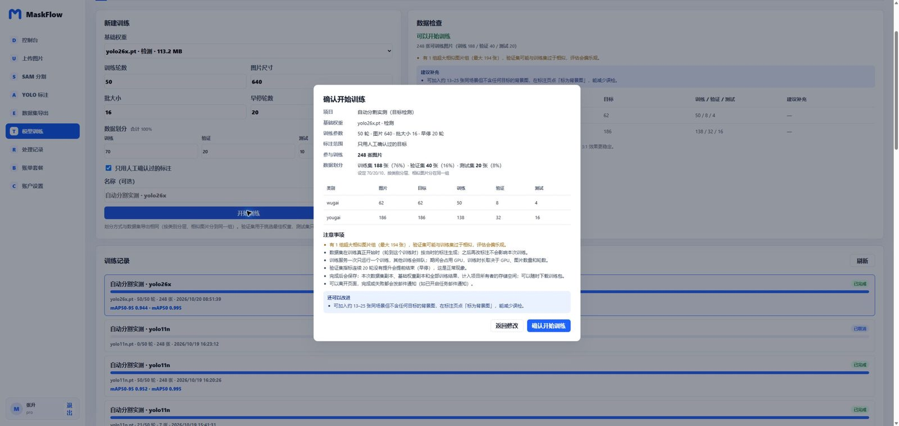
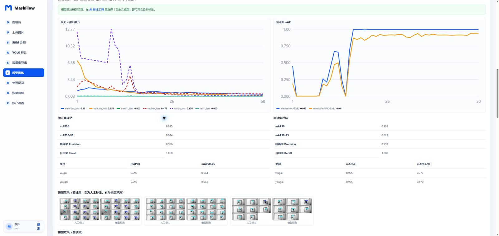
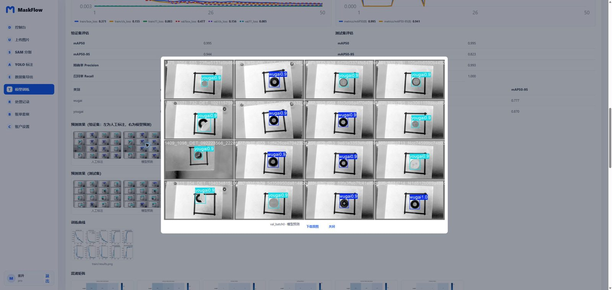
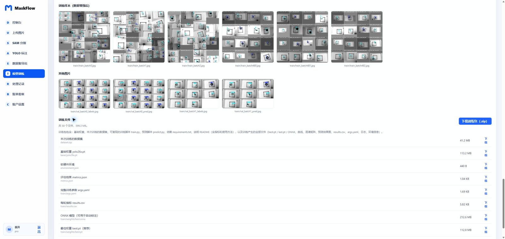
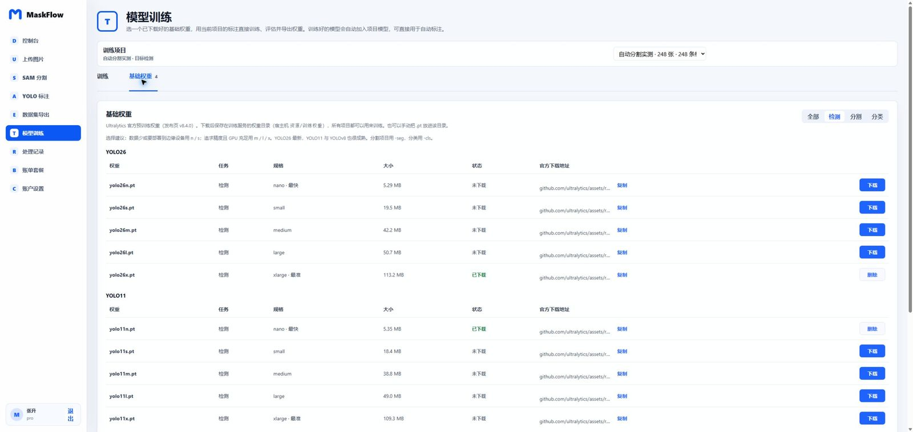
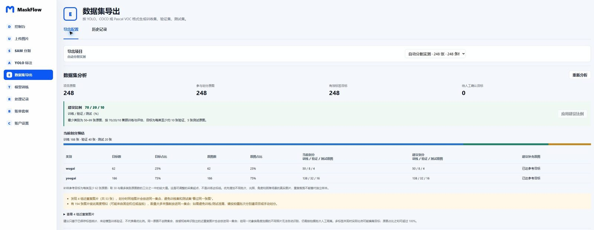
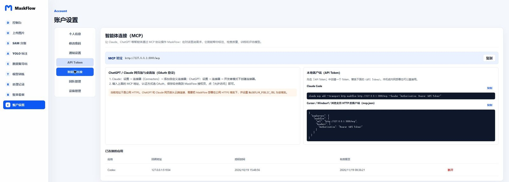
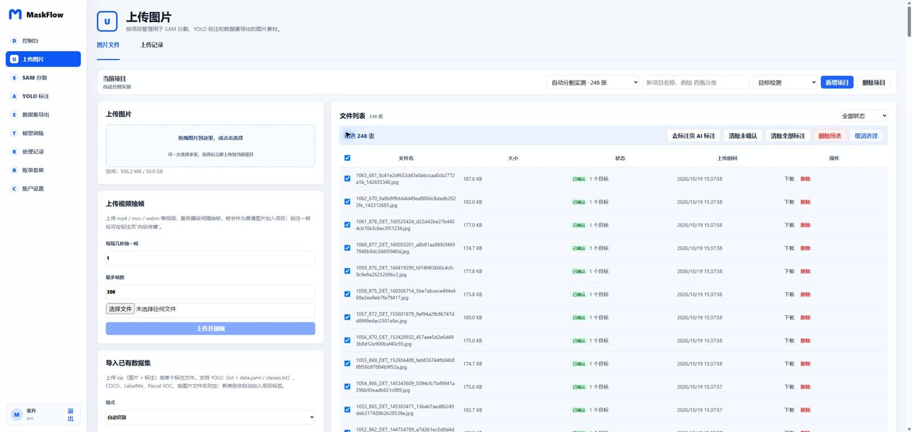

<div align="center">

# MaskFlow

**[中文](./README.md) · English**

**Just upload images — AI does the rest: annotation, quality checks, training and evaluation, fully automated in one place**

A self-hosted vision data platform built on SAM 3, YOLO26 / YOLO11, MCP, Vue 3, ASP.NET Core and FastAPI.<br/>
Click through the web app, or simply ask Claude, ChatGPT or Codex in a chat.

[](https://github.com/ZhangEmo28/maskflow/actions/workflows/ci.yml)
[](./LICENSE)
[](https://github.com/ZhangEmo28/maskflow/releases)
[](./文档/智能体连接.md)
[](https://vuejs.org/)
[](https://dotnet.microsoft.com/)

</div>

<p align="center">
  <a href="./docs/screenshots/annotation-workbench.jpg">
    
  </a>
</p>

<p align="center">Auto-labelling new images with the <code>yolo26x</code> model just trained in MaskFlow — annotate → train → the model comes back to the annotation tool.</p>

## Three ideas

<table>
  <tr>
    <td width="33%" valign="top">
      <h3>🤖 Fully automatic</h3>
      SAM 3 finds and classifies objects by your label names; batch annotation runs on the server even after you close the page; video labels propagate frame by frame; trained models are registered for auto-annotation; before training, the data is checked and you are told how many more images of which kind to add.
    </td>
    <td width="33%" valign="top">
      <h3>🧩 One-stop</h3>
      Upload → AI annotation → review → quality checks → dataset split and export → one-click training → evaluation → download the training package. Data, labels, weights and results live in one place — no shuffling files between tools and scripts.
    </td>
    <td width="33%" valign="top">
      <h3>💬 MCP agents</h3>
      A built-in MCP server lets Claude, ChatGPT, Codex and Cursor annotate, visually inspect, fix, quality-check, train and evaluate from a chat — the agent actually “sees” the labels drawn on the image.
    </td>
  </tr>
</table>

```text
Upload images / videos / existing datasets
        │
        ▼
AI annotation ── (SAM 3 by label · segment everything · your own trained model)
        │
        ▼
Human or agent review ── quality checks (duplicates, unlabeled, low confidence, sparse classes…)
        │
        ▼
Training data check ── minimum images, per-class split, what to add
        │
        ▼
One-click training (YOLO26 / YOLO11 / YOLOv8) ── val / test evaluation
        │
        ├──► Training package: base weight + dataset + training script + every output
        └──► The model returns to the annotation tool to label new images
```

## One-stop training and evaluation

<table>
  <tr>
    <td width="50%" align="center"><strong>Confirm before training: images, split and notes</strong></td>
    <td width="50%" align="center"><strong>Live curves and val / test evaluation</strong></td>
  </tr>
  <tr>
    <td><a href="./docs/screenshots/training-confirm.jpg"></a></td>
    <td><a href="./docs/screenshots/training-metrics.jpg"></a></td>
  </tr>
  <tr>
    <td align="center"><strong>Model predictions next to the human labels</strong></td>
    <td align="center"><strong>Training files and one-click package download</strong></td>
  </tr>
  <tr>
    <td><a href="./docs/screenshots/training-predictions.jpg"></a></td>
    <td><a href="./docs/screenshots/training-package.jpg"></a></td>
  </tr>
  <tr>
    <td align="center"><strong>Base weights: official YOLO26 / YOLO11 / YOLOv8, one-click download</strong></td>
    <td align="center"><strong>Dataset analysis: class balance, split preview, near-duplicates</strong></td>
  </tr>
  <tr>
    <td><a href="./docs/screenshots/base-weights.jpg"></a></td>
    <td><a href="./docs/screenshots/dataset-analysis.jpg"></a></td>
  </tr>
</table>

## Drive MaskFlow from an agent (MCP)

<p align="center">
  <a href="./docs/screenshots/mcp-connection.jpg"></a>
</p>

Once connected, just say things like:

> Look at the “Site” project and label hard hats and safety vests. Do two images first so I can check, then the rest, and finish with a quality check.

> Is there enough data to train? If not, tell me how many more images each class needs. If yes, train yolo26s for 100 epochs and walk me through the per-class results and the confusion matrix.

> Evaluate the new model on the confirmed images and show me the images it gets most wrong.

The agent calls MaskFlow's tools: it can look at the labels drawn on an image, judge them and fix the boxes. Anything it adds or changes is saved as *unconfirmed*; it only marks targets human-confirmed after you agree.

**MCP endpoint**: `http(s)://your-domain/mcp` (locally `http://127.0.0.1:3000/mcp`), copyable from *Account settings → Agent connection*. Authenticate with either:

| Client | How to connect |
| --- | --- |
| **Claude Code** | `claude mcp add --transport http maskflow http://127.0.0.1:3000/mcp --header "Authorization: Bearer <API token>"`<br/>Or omit `--header` and run `/mcp` in Claude Code to authorize in the browser (OAuth). |
| **Codex** | Add the config below to `~/.codex/config.toml` and authorize in the browser (OAuth) on first use. |
| **Cursor / Windsurf …** | Put `url` and an `Authorization: Bearer <API token>` header in `mcp.json` (below). |
| **Claude web / desktop** | Settings → Connectors → Add custom connector, enter the MCP endpoint and click *Allow* on the MaskFlow consent page. |
| **ChatGPT** | Enable developer mode in the connector settings, add a custom MCP connector, choose OAuth. |

```toml
# ~/.codex/config.toml
[mcp_servers.maskflow]
url = "http://127.0.0.1:3000/mcp"
```

```json
{
  "mcpServers": {
    "maskflow": {
      "url": "http://127.0.0.1:3000/mcp",
      "headers": { "Authorization": "Bearer <API token>" }
    }
  }
}
```

- **API tokens** (`mf_…`) are created in *Account settings → API Token*; good for local or LAN clients.
- **OAuth 2.1** (dynamic registration + PKCE) is for cloud connectors. ChatGPT and Claude web connect from the cloud, so MaskFlow must be served on a **public HTTPS domain** with `MASKFLOW_PUBLIC_URL` set to it. Connected apps can be revoked under *Agent connection* at any time.

Main tools (25 in total; see [文档/智能体连接.md](./文档/智能体连接.md)):

| Area | Tools |
| --- | --- |
| Projects and data | `list_projects` `get_project` `create_project` `update_labels` `list_images` `export_dataset` |
| Annotation | `auto_annotate_image` `auto_annotate_project` `get_task` `get_annotations` `view_image` (returns the image with labels drawn) `edit_annotations` `confirm_annotations` `clear_annotations` `review_image` |
| Quality | `check_quality` `check_training_data` |
| Training and evaluation | `list_base_weights` `start_training` `get_training` `list_trainings` `cancel_training` `view_training_plot` `list_models` `evaluate_model` |

## Features

**Data**
- Per-project image management: drag & drop or pick-to-upload, filter by status (unannotated / pending / confirmed / background), Shift-select for batch AI annotation, clearing labels or deleting.
- Video upload with frame extraction; import existing datasets (YOLO / COCO / LabelMe / Pascal VOC, zip or a single annotation file).

<p align="center"><a href="./docs/screenshots/files-bulk-selection.jpg"></a></p>

**Automatic annotation**
- SAM 3 finds every project label by name (Chinese labels can have English prompts, e.g. 安全帽 → hard hat), each target with class and confidence; “segment everything” and positive/negative point prompts too.
- Pre-label with your own YOLO model (ONNX); models trained in MaskFlow are registered automatically.
- Server-side batch annotation with progress, cancel and resume after restarts; human-confirmed targets are never overwritten; images where nothing is detected stay *unannotated* and are counted separately instead of being treated as done.
- Video: label one frame and SAM propagates the boxes forward, keeping each object's class.

**Review and quality**
- Move / resize boxes, edit polygon vertices, undo / redo, wheel zoom and space-drag pan, full keyboard shortcuts (`R` runs AI, `1–9` set labels, `A`/`D` switch images, `Ctrl+S` saves…), optional “next image after save”.
- Lowest-confidence-first review; images with genuinely nothing in them can be marked as *background* (negative samples).
- Quality checks: unlabeled, invalid / tiny / huge boxes, duplicates, one object with two classes, low-confidence unconfirmed targets, missing polygons, sparse or imbalanced classes.

**Export and training**
- Export YOLO detect / segment, COCO, Pascal VOC and classification crops; stratified train / val / test split with near-duplicates kept together; optionally only human-confirmed targets.
- Training data check: at least 20 annotated images and 10 per class (configurable); per-class train / val / test counts; advice on how many more images of which kind to add.
- Base weights: official Ultralytics YOLO26 / YOLO11 / YOLOv8 (n–x, detect / segment / classify, 45 in total), one-click download with size verification, delete when no longer needed.
- One-click training: a confirmation dialog with image counts and split; live loss and mAP curves; val / test and per-class evaluation; predictions next to labels, confusion matrices, PR / F1 curves, augmented samples.
- Training package: base weight, the exact dataset, `train.py` (reproduce with one command), `predict.py`, `requirements.txt`, a README with metrics and usage, and every file the run produced (best / last / ONNX, plots, logs, environment).
- Model evaluation against human-confirmed labels: per-class precision / recall / F1 and the worst images.

**Collaboration and operations**
- Project members and roles (owner / reviewer / annotator / viewer), invitations, image assignment, submit → approve / reject review; email for invitations, password reset and task notifications.
- Storage and daily AI quotas, task history; one-command Docker Compose deployment with MySQL and MinIO.

## Quick start

### 1. Requirements

- Docker Desktop or Docker Engine + Compose
- An NVIDIA GPU, driver and NVIDIA Container Toolkit (for SAM 3 inference and training)
- Approved SAM 3 model weights

> SAM 3 weights are not downloaded automatically. Request access on the [Meta SAM 3 Hugging Face page](https://huggingface.co/facebook/sam3), download `sam3.pt` once approved, and follow its license terms. YOLO base weights for training need no preparation — download them in the web app.

### 2. Get and configure

```bash
git clone https://github.com/ZhangEmo28/maskflow.git
cd maskflow
cp .env.example .env
mkdir -p 资源/模型
# put the downloaded sam3.pt at 资源/模型/sam3.pt
```

### 3. Start

```bash
# Everything: annotation, export, MCP …
docker compose up -d --build

# Add the training service when you want to train (same image, separate container)
docker compose --profile training up -d --build
```

| Service | Local address | Notes |
|---|---|---|
| Web | http://127.0.0.1:3000 | MaskFlow workbench; MCP at `/mcp` |
| API | http://127.0.0.1:8000 | Business API |
| SAM | http://127.0.0.1:8001 | Inference service |
| Trainer | container network only | Started with `--profile training`, called by the API |
| MinIO Console | http://127.0.0.1:9001 | Object storage |
| MySQL | 127.0.0.1:3307 | Database |

Everything binds to loopback by default. The database schema is created on first start.

### 4. First steps

1. Open http://127.0.0.1:3000 and sign up. **The first account is the administrator** and can download / delete base weights (or set `MASKFLOW_ADMIN_EMAILS`).
2. *Model training → Base weights*: download a starter weight such as `yolo26n.pt` (`-seg` for segmentation projects, `-cls` for classification).
3. *Upload images*: create a project, add labels, drag images in.
4. *YOLO annotation*: choose “by label (SAM 3)”, press `R` on one image to check, then *Run AI on all*; review with status filters and shortcuts, then save.
5. *Model training*: follow the data check on the right; when it passes, click *Start training* and confirm the image counts and split.
6. When it finishes, review the evaluation and result images and download the training package; the trained model already appears under *custom model* in the annotation tool.
7. To do all of this from a chat, connect Claude / ChatGPT / Codex as described above.

## Configuration

Common settings in `.env` (see `.env.example` and `.env.production.example`):

| Variable | Purpose |
| --- | --- |
| `MASKFLOW_PUBLIC_URL` | Public address: used in emails and as the MCP / OAuth issuer; must be public HTTPS for ChatGPT and Claude web. |
| `MASKFLOW_ADMIN_EMAILS` | Admins allowed to download / delete base weights (comma separated); empty means the first registered account. |
| `MASKFLOW_TRAIN_MIN_IMAGES` / `MASKFLOW_TRAIN_MIN_PER_CLASS` | Minimum data for training, default 20 images / 10 per class. |
| `TRAIN_WEIGHT_BASE_URL` | Where official weights are downloaded from (Ultralytics assets v8.4.0); point it at a mirror if GitHub is slow. |
| `MASKFLOW_SMTP_*` | Email for password reset, invitations and task notifications. |
| `MASKFLOW_AI_DAILY_LIMIT` | Daily AI quota per account. |
| `MASKFLOW_TRUSTED_PROXIES` | Trusted proxy networks when another reverse proxy sits in front. |
| `SAM3_INTERNAL_KEY` | Shared key between the API and the inference / training services. |

## Production

```bash
cp .env.production.example .env
```

1. Replace every `replace-me` value with strong, unique secrets.
2. Set `MASKFLOW_PUBLIC_URL`, `MASKFLOW_CORS_ORIGINS` and `SAM3_CORS_ORIGINS` to your real HTTPS domain.
3. Put a TLS reverse proxy in front of the web service. The bundled nginx forwards `/api`, `/mcp` (unbuffered for streaming), `/oauth/` and `/.well-known/oauth-*` to the API; forward the same paths in any outer proxy and set `MASKFLOW_TRUSTED_PROXIES`.
4. Configure SMTP, otherwise password reset and invitation emails cannot be sent.
5. Keep SAM, MySQL, MinIO, the API and the trainer on `127.0.0.1` or a private network.
6. The trainer's weight folder `资源/训练权重` must be writable (weights downloaded from the web app go there).
7. Run `docker compose --profile training config --quiet` before starting.

Production mode rejects sample / development secrets and forbids `MASKFLOW_BILLING_DEV_MODE`.

## Common commands

```bash
docker compose --profile training up -d --build                    # start or update everything
docker compose up -d --build web api                               # update web and API only
docker compose --profile training up -d --build sam-inference trainer
docker compose ps
docker compose logs -f api trainer
docker compose --profile training down                             # stop, keep data
```

## Architecture

```text
Browser (Vue 3)          Agents (Claude / ChatGPT / Codex / Cursor)
      │                          │  MCP (Streamable HTTP, API token / OAuth 2.1)
      ▼                          ▼
   nginx ──► MaskFlow API (ASP.NET Core 9) ──► MySQL / MinIO
                 │               │
                 ▼               ▼
         SAM inference        Trainer
     (FastAPI + SAM 3 + ONNX)  (FastAPI + Ultralytics, one subprocess per run)
```

| Component | Stack | Path |
|---|---|---|
| Web workbench | Vue 3, Vite, nginx | `src/frontend/maskflow-web` |
| API and MCP server | ASP.NET Core 9, ModelContextProtocol SDK, MySqlConnector, SkiaSharp, MailKit | `src/backend/maskflow-api` |
| Inference and training | FastAPI, Ultralytics, PyTorch, ONNX Runtime, OpenCV | `src/ai/sam-inference` (`app/main.py` inference, `app/trainer.py` training) |
| Tests | xUnit, WebApplicationFactory, pytest, node:test, GitHub Actions | `src/backend/maskflow-api.tests` and others |

## Local development

```bash
# Frontend (proxies /api, /mcp, /oauth, /.well-known to 127.0.0.1:8010)
cd src/frontend/maskflow-web && npm ci && npm run dev -- --host 127.0.0.1 --port 3000

# API
export MASKFLOW_MYSQL='Server=127.0.0.1;Port=3306;Database=maskflow;User ID=maskflow;Password=maskflow;Allow User Variables=true;'
export MASKFLOW_PUBLIC_URL=http://localhost:3000
dotnet run --project src/backend/maskflow-api/MaskFlow.Api.csproj --urls http://127.0.0.1:8010

# Inference and training services
cd src/ai/sam-inference && python -m venv .venv && source .venv/bin/activate && pip install -r requirements.txt
python -m uvicorn app.main:app --host 127.0.0.1 --port 8001
TRAIN_WEIGHTS_DIR=./weights TRAIN_RUNS_DIR=./runs python -m uvicorn app.trainer:app --host 127.0.0.1 --port 8002
```

The API reaches them via `SAM_SERVICE_URL` (default `http://localhost:8001`) and `TRAINER_SERVICE_URL` (default `http://localhost:8002`). Swagger in development: http://127.0.0.1:8010/swagger

## Tests and CI

Every push and pull request runs `npm audit`, `npm test` and the frontend build; `dotnet test` (including MySQL 8.4 integration, end-to-end API, MCP and OAuth flows); `pytest` for the inference and training services (stub models and a stub Ultralytics, no GPU needed); and `docker compose config`.

## Contributing

Issues and pull requests are welcome via [GitHub](https://github.com/ZhangEmo28/maskflow/issues). Make sure CI passes and do not commit model weights, datasets, secrets or local runtime files. Detailed change history: [文档/修改记录.md](./文档/修改记录.md).

## License

MaskFlow is released under the [GNU Affero General Public License v3.0](./LICENSE). If you offer a modified MaskFlow as a network service, comply with the AGPL-3.0 source-availability obligations.

SAM 3, Ultralytics YOLO weights and other third-party components are subject to their own terms; see [Third-Party Notices](./THIRD_PARTY_NOTICES.md).
